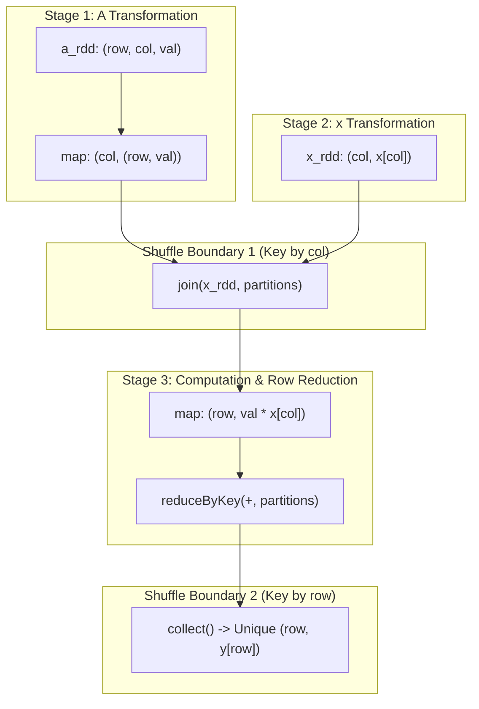
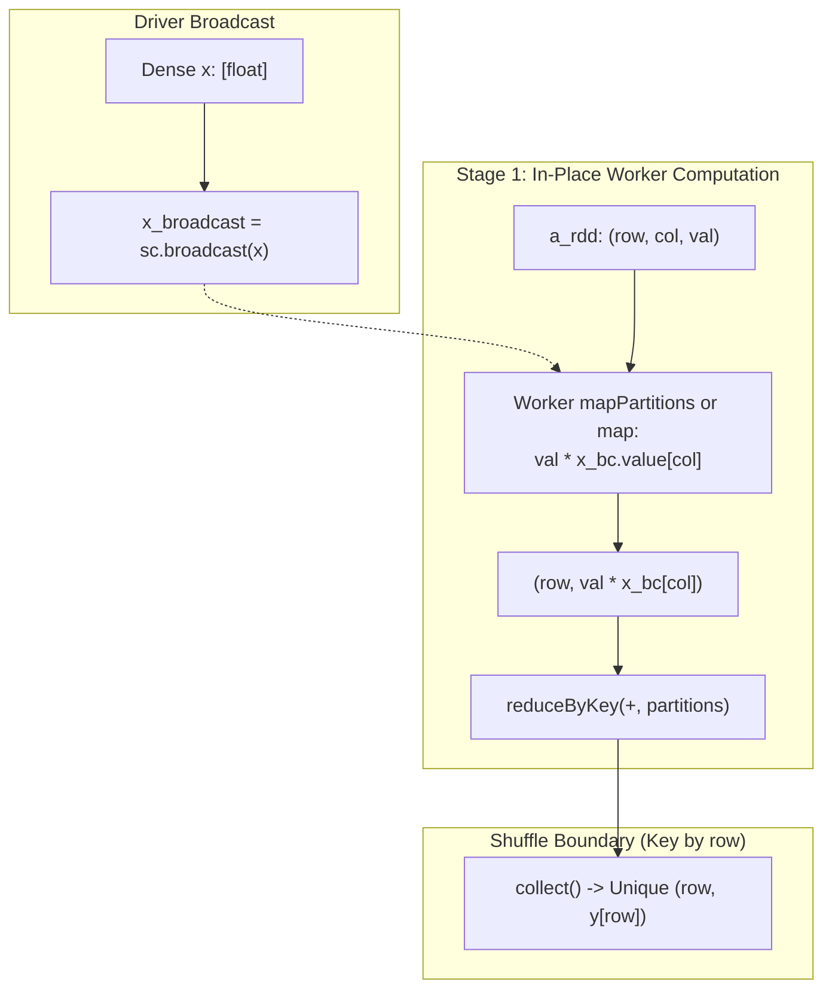
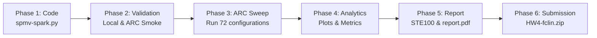

# CSC 548 HW4 (Spark SpMV) Execution Plan

> **Course:** CSC 548: Parallel Systems (Fall 2026)  
> **Topic:** Distributed Sparse Matrix-Vector Multiplication (SpMV) in Apache Spark  
> **Student Unity ID:** `fclin`  
> **Target Package:** `HW4-fclin.zip` containing `spmv-spark.py`, `report.pdf`, and `plots/`  
> **Due Date:** Wednesday, November 11, 2026 at 11:59 PM ET (100 Points)

---

## 1. Executive Summary & Grading Breakdown

This project transitions SpMV from high-performance native HPC runtimes (C/MPI in HW1, OpenMP in HW2, and CUDA in HW3) to Apache Spark's distributed dataflow engine. The core objective is twofold:
1. Implement and verify distributed SpMV under both **Shuffle Join** and **Broadcast** (or **Co-partitioning**) schemes.
2. Measure and explain the architectural, serialization, and communication costs that make Spark $10\times\text{--}100\times$ slower than native kernels on sparse numerical linear algebra.

```
+-----------------------------------------------------------------------------------------+
|                                    GRADING RUBRIC (100 pts)                             |
+------------------------------+--------+-------------------------------------------------+
| Component                    | Points | Focus Areas                                     |
+------------------------------+--------+-------------------------------------------------+
| Spark SpMV Correctness       | 40 pts | Valid result RDDs, relative L2 <= 1e-8 baseline |
| Partitioning Implementation  | 15 pts | Controllable partition count, join vs broadcast |
| Partition & Shuffle Study    | 15 pts | Scaling sweep (1-32), shuffle bytes/stages      |
| Cross-Model Analysis         | 25 pts | HW1/HW2/HW3 comparison, 10-100x slowdown root  |
| Report Quality & Write-up    |  5 pts | Figures, tables, STE100 clear prose             |
+------------------------------+--------+-------------------------------------------------+
```

---

## 2. Technical Design & Algorithm Specifications

All implementations reside in [`hw4/SpMV/spmv-spark.py`](file:///c:/Users/fclin/git/CSC548/hw4/SpMV/spmv-spark.py).

### 2.1 Task 1: Matrix Ingestion & Distribution

```python
def make_matrix_rdd(sc, entries, partitions):
    """Return an RDD of (row, col, val) with exactly `partitions` slices."""
    return sc.parallelize(entries, numSlices=partitions)
```
- **Driver Ingestion:** Matrix Market entries are loaded on driver, symmetry expanded, and values randomized in double-precision float.
- **Partitioning:** The raw entry list is sliced across worker nodes into exactly `partitions` RDD partitions.
- **Persistence:** The harness persists `a_rdd` with `StorageLevel.MEMORY_AND_DISK` to isolate SpMV computation from file I/O and driver slicing.

---

### 2.2 Task 2: Scheme A — Column Shuffle Join (`spmv_join`)

In this baseline scheme, vector $x$ is treated as an RDD of `(col, x[col])`.



**Step-by-Step DAG:**
1. **Re-key $A$ by column:** `a_col = a_rdd.map(lambda rcv: (rcv[1], (rcv[0], rcv[2])))` $\rightarrow$ `(col, (row, val))`
2. **Key-Join with $x$:** `joined = a_col.join(x_rdd, numPartitions=partitions)` $\rightarrow$ `(col, ((row, val), x_val))`
   - *Shuffle Cost:* Re-hashes and shuffles both $A$ nonzeros and $x$ across the network on key `col`.
3. **Compute partial products:** `products = joined.map(lambda kv: (kv[1][0][0], kv[1][0][1] * kv[1][1]))` $\rightarrow$ `(row, val * x_val)`
4. **Aggregate by row:** `y_rdd = products.reduceByKey(lambda a, b: a + b, numPartitions=partitions)`
   - *Shuffle Cost:* Re-hashes and shuffles partial products across the network on key `row`.

---

### 2.3 Task 3: Scheme B — Broadcast Lookup (`spmv_broadcast`)

Because vector $x$ is dense and fits easily in executor memory (e.g., $1.97\text{M}$ doubles $\approx 15.8\text{ MB}$ for `roadNet-CA`), broadcasting $x$ directly eliminates the entire first shuffle stage.



**Step-by-Step DAG:**
1. **Direct product generation:**
   ```python
   def spmv_broadcast(a_rdd, x_broadcast, partitions):
       x_vec = x_broadcast.value
       return (
           a_rdd.map(lambda rcv: (rcv[0], rcv[2] * x_vec[rcv[1]]))
                .reduceByKey(lambda a, b: a + b, numPartitions=partitions)
       )
   ```
2. **Stage Elimination:** The column join shuffle is completely removed. Only the final `reduceByKey` row aggregation requires a shuffle stage.

---

### 2.4 Verification & Correctness Contract

- **Sequential Reference:** Driver runs `sequential_spmv(rows, entries, x)` in double precision.
- **Sparse-to-Dense Assembly:** Driver fills zero entries for unvisited rows via `dense_result(pairs, rows)`.
- **Metric:** Relative L2 norm $\le 10^{-8}$:
  $$\epsilon = \frac{\|y_{\text{spark}} - y_{\text{seq}}\|_2}{\max(\|y_{\text{seq}}\|_2, 10^{-30})} \le 10^{-8}$$

---

## 3. Dataset Matrix Profiles

The benchmark suite features 6 SuiteSparse matrices covering contrasting sparsity structures, aspect ratios, and variance:

| Matrix | Rows ($m$) | Columns ($n$) | Expanded NNZ | Size | Structure Profile | Relevance to Spark SpMV |
| :--- | :---: | :---: | :---: | :---: | :--- | :--- |
| `D6-6` | 120,576 | 23,740 | 146,880 | 2.0 MB | Rectangular, small footprint | Smoke testing & harness baseline validation |
| `bfly` | 49,152 | 49,152 | 196,608 | 1.1 MB | Perfect regular butterfly graph ($\mu=4$) | Ideal uniform partition balance |
| `dictionary28` | 52,652 | 52,652 | 178,076 | 0.9 MB | Extremely sparse text graph | Communication dominates over computation |
| `roadNet-CA` | 1,971,281 | 1,971,281 | 5,533,214 | 39.2 MB | Enormous row count, planar graph | Tests row-key hash distribution & broadcast memory |
| `Ga3As3H12` | 61,349 | 61,349 | 5,970,947 | 90.6 MB | High density, extreme row variance ($K=1622$) | Severe reduceByKey skew & executor stragglers |
| `pkustk14` | 151,926 | 151,926 | 14,836,504 | 88.0 MB | Largest NNZ count (~14.8M) | Maximizes network shuffle I/O & JVM GC pressure |

---

## 4. Empirical Benchmarking Plan (ARC Cluster)

### 4.1 Deployment Environment
- **Platform:** NC State ARC Cluster compute nodes.
- **Configuration:** Dual Intel Xeon / AMD EPYC, 16 allocated cores (`--cpus-per-task=16`), 16 GB driver memory (`--driver-memory 16g`).
- **Software Stack:** Spark 3.5.0, Python 3.11, OpenJDK 8.

### 4.2 Parameter Sweep Grid ([`sweep.sbatch`](file:///c:/Users/fclin/git/CSC548/hw4/SpMV/sweep.sbatch))

| Sweep Dimension | Values | Total Combinations |
| :--- | :--- | :---: |
| **Matrices** | `D6-6`, `dictionary28`, `bfly`, `roadNet-CA`, `Ga3As3H12`, `pkustk14` | 6 |
| **Schemes** | `join`, `broadcast` | 2 |
| **Partitions ($p$)** | $1, 2, 4, 8, 16, 32$ | 6 |
| **Fixed Parameters** | Cores: 4, Warmup: 1, Timed Iters: 5 | 72 configurations |

### 4.3 Supplemental Strong-Scaling Core Sweep
To address Report Task 2's strong scaling / executor core analysis:
- Fix matrix: `pkustk14` and `roadNet-CA` at $p=16$ partitions.
- Vary executor cores: $c \in \{1, 2, 4, 8, 16\}$ using `spark-submit --master local[$c]`.

### 4.4 Data Collection Pipeline
- Output directory: `results/<jobid>/`
- Runtimes & correctness: `spark.csv`
- Detailed shuffle & stage metrics: `tools/event_metrics.py` parses event logs into `shuffle.csv`:
  - `stages`: Executed stages (excludes skipped stages)
  - `shuffle_read_bytes`: Remote + Local shuffle bytes read
  - `shuffle_write_bytes`: Total shuffle bytes written to disk/network
  - `executor_run_ms`, `executor_deserialize_ms`, `result_serialize_ms`

---

## 5. Cross-Model Architectural Analysis (HW1 vs HW2 vs HW3 vs HW4)

A dedicated section of the report must address: **Why is Spark typically $10\times\text{--}100\times$ slower than MPI, OpenMP, and CUDA?**

```
+---------------------------------------------------------------------------------------------------------+
|                                    ARCHITECTURAL COMPARISON MATRIX                                      |
+-------------------+--------------------+--------------------+--------------------+----------------------+
| Feature           | HW1 (MPI)          | HW2 (OpenMP)       | HW3 (CUDA)         | HW4 (Apache Spark)   |
+-------------------+--------------------+--------------------+--------------------+----------------------+
| Granularity       | Coarse process     | Fine thread        | Massive SIMT warp  | Distributed RDD task |
| Vector Access     | MPI_Allgatherv     | Shared L1/L2/L3    | Shared/Global Mem  | Network Shuffle / BC |
| Vector Transfer   | 1x per iteration   | 0x (cache-hit)     | 1x HtoD copy       | Py4J / JVM / Network |
| Arithmetic Kernel | Vectorized C loops | Vectorized C loops | 5,120 CUDA cores   | Python Py4J iterator |
| Latency Scale     | ~1 - 50 ms         | ~0.5 - 20 ms       | ~0.1 - 5 ms        | ~500 - 5,000 ms      |
+-------------------+--------------------+--------------------+--------------------+----------------------+
```

### Key Analytical Pillars for the Report:
1. **Lineage & DAG Scheduling Overhead:** Spark submits DAG stages, serializes tasks, schedules tasks to thread pools, and logs state transitions. In native C/CUDA, kernel launch overhead is $<5\ \mu\text{s}$; in Spark, task scheduling latency is $\approx 5\text{--}20\text{ ms}$ per partition.
2. **Shuffle Subsystem Bottleneck:** The `join` scheme performs wide dependencies: partitioning, serializing to disk buffers, transferring over TCP sockets, deserializing, and sorting. The `broadcast` scheme eliminates the column shuffle but still incurs shuffle on `reduceByKey`.
3. **Serialization & Language Boundary (Py4J):** PySpark runs Python worker processes communicating with the JVM via local loopback sockets. Every tuple `(row, col, val)` undergoes Python object boxing $\rightarrow$ pickle serialization $\rightarrow$ socket transfer $\rightarrow$ JVM unboxing.
4. **ETL vs. Dense/Sparse Arithmetic Specialization:** Spark is engineered for high-throughput batch ETL, fault tolerance, and disk spillover, whereas SpMV is an extreme memory-bandwidth-bound linear algebra kernel needing close-to-metal SIMD register utilization.

---

## 6. Plotting & Report Deliverables

### 6.1 Planned Figures
- **Figure 1: Scheme Scaling Comparison (Runtime vs. Partitions):**
  Dual-panel plot for all 6 matrices comparing `join` vs. `broadcast` across $p \in \{1, 2, 4, 8, 16, 32\}$.
- **Figure 2: Shuffle Communication Volume:**
  Bar chart / log-scale plot of Shuffle Read and Write bytes vs. partition count, proving how `broadcast` eliminates Stage 1 shuffle data.
- **Figure 3: Spark Strong Scaling & Parallel Efficiency:**
  Speedup $S(p) = T(1) / T(p)$ and Efficiency $E(p) = S(p)/p$ across partition counts and core counts.
- **Figure 4: Cross-Model Runtime Comparison (HW1 vs. HW2 vs. HW3 vs. HW4):**
  Log-scale execution time comparison across all 4 paradigms on identical benchmark matrices.

### 6.2 Report Artifacts
- Script: `generate_plots.py` (Matplotlib figures styled cleanly in `results/plots/`)
- Report source: `report.md` (Strict ASD-STE100 compliance, structured tables, quantitative findings)
- PDF Compiler: `build_report.py` (ReportLab generator creating `report.pdf`)
- Final submission archive: `HW4-fclin.zip`

---

## 7. Phased Implementation Roadmap



| Phase | Milestone | Key Actions & Tools |
| :---: | :--- | :--- |
| **1** | **Implementation** | Code `make_matrix_rdd`, `spmv_join`, `spmv_broadcast` in `spmv-spark.py`. |
| **2** | **Smoke Testing** | Run test harness on `D6-6` and `bfly` with `join` and `broadcast` schemes; verify `check: PASS`. |
| **3** | **ARC Cluster Execution** | Deploy to ARC via sync script, launch `sweep.sbatch`, monitor completion, extract `shuffle.csv`. |
| **4** | **Data Synthesis & Plotting** | Write `generate_plots.py` to process `spark.csv`, `shuffle.csv`, and HW1–HW3 historical results. |
| **5** | **Report Authoring** | Draft `report.md` answering all rubric prompts; compile to publication-quality `report.pdf`. |
| **6** | **Packaging & Verification** | Create `HW4-fclin.zip`, verify directory tree integrity, ensure zero missing files. |

---

## 8. Open Questions & Recommendations

1. **Broadcast vs. Co-partitioning:**  
   The starter code provides a broadcast template (`spmv_broadcast`), which is simpler, highly efficient, and fits nicely into memory for all 6 test matrices ($x \le 16\text{ MB}$). Implementing `broadcast` satisfies Task 2. Do you prefer the **broadcast** strategy or would you like to also include an explicit **co-partitioning** scheme?
2. **Local vs. ARC Sweep Execution:**  
   Local PySpark on Windows encounters known Python 3.13 / Java 21 socket incompatibility. We recommend running the full 72-configuration sweep on **ARC** (Python 3.11 / Spark 3.5.0) via `sweep.sbatch`, replicating the successful HW3 workflow.
