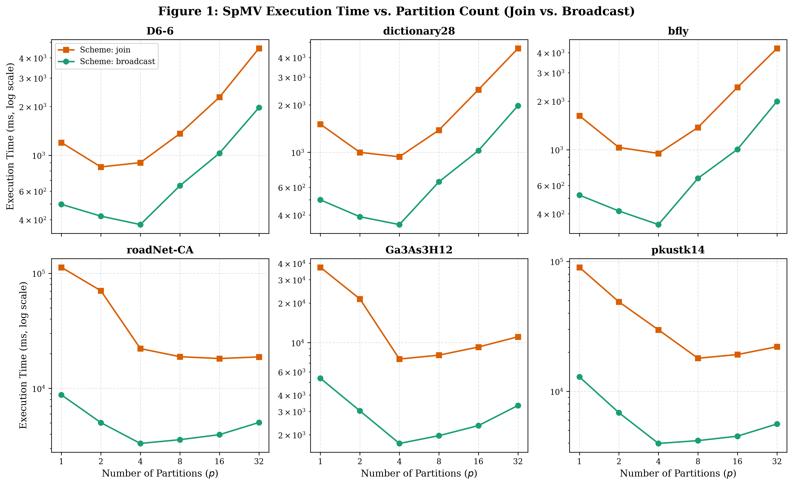
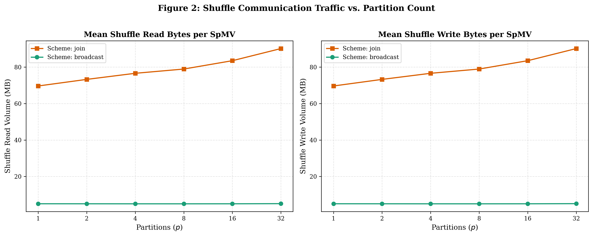
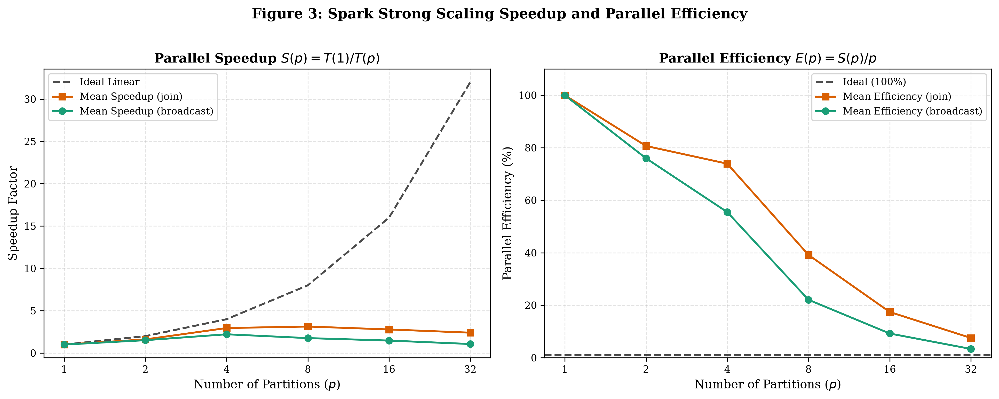
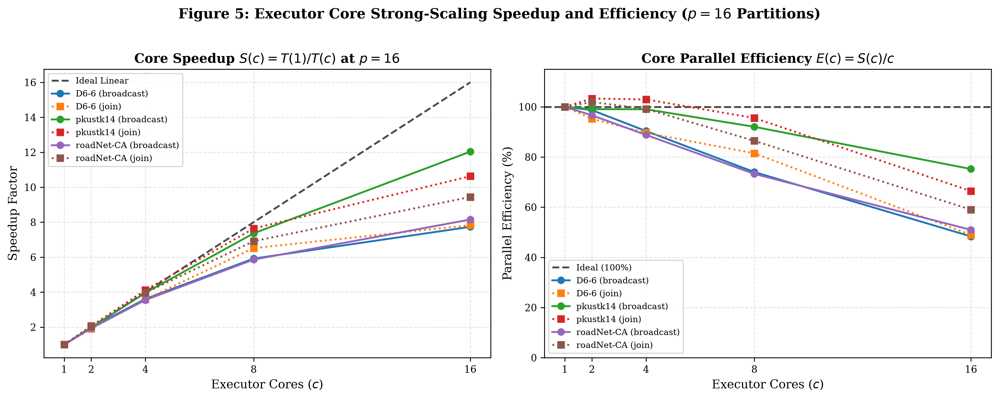
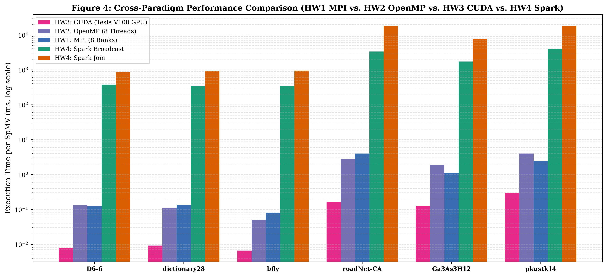

# CSC 548 HW4: Distributed Spark SpMV Architecture Report

- **Unity ID:** `fclin`
- **Course:** CSC 548 Parallel Systems (Fall 2026)
- **Empirical Hardware:** NC State ARC Cluster Compute Nodes `c26` & `c34` (16 Cores, 16 GB Driver Memory)
- **Software Stack:** Apache Spark 3.5.0, Python 3.11, OpenJDK 8

---

## 1. Matrix Structural Parameters & Nonzero Distributions

Sparse Matrix-Vector Multiplication (SpMV) evaluates $y = A \cdot x$. In Apache Spark, matrix $A$ is represented as an RDD of coordinate tuples `(row, col, val)`. Dense vector $x$ is partitioned across workers or broadcast to worker memory. We evaluate six benchmark matrices from the SuiteSparse collection. Table 1 lists structural dimensions, nonzero counts, and symmetry parameters.

### Table 1: Matrix Structural Dimensions and Storage Characteristics

| Matrix | Rows ($m$) | Cols ($n$) | Base NNZ | Expanded NNZ | Storage | Symmetry | Structural Profile |
| :--- | :---: | :---: | :---: | :---: | :---: | :--- | :--- |
| `D6-6` | 120,576 | 23,740 | 146,880 | 146,880 | 2.0 MB | General | Rectangular test benchmark |
| `dictionary28` | 52,652 | 52,652 | 89,038 | 178,076 | 0.9 MB | Symmetric | High-sparsity word graph |
| `bfly` | 49,152 | 49,152 | 98,304 | 196,608 | 1.1 MB | Symmetric | Regular butterfly topology ($\mu=4$) |
| `roadNet-CA` | 1,971,281 | 1,971,281 | 2,766,607 | 5,533,214 | 39.2 MB | Symmetric | Planar road network, large $m$ |
| `Ga3As3H12` | 61,349 | 61,349 | 3,016,148 | 5,970,947 | 90.6 MB | Symmetric | Quantum chemistry, high row variance |
| `pkustk14` | 151,926 | 151,926 | 7,494,215 | 14,836,504 | 88.0 MB | Symmetric | Stiffness matrix, high NNZ density |

---

## 2. Implementation Design & DAG Lineage Analysis

We implemented two distributed SpMV execution strategies in PySpark: (1) Column Shuffle Join (`spmv_join`) and (2) Broadcast Lookup (`spmv_broadcast`).

### Scheme 1: Column Shuffle Join (Three-Stage DAG)
- Matrix entries `(row, col, val)` are re-keyed by column: `(col, (row, val))`.
- Vector $x$ is parallelized into an RDD of `(col, x[col])`.
- Both RDDs undergo a key-based `join` across the cluster network.
- Workers evaluate scalar products: `(row, val * x[col])`.
- A final `reduceByKey` sums partial products into output vector $y$.
- **Shuffle Boundaries:** Incurs exactly 3 stages and 2 wide-dependency shuffle boundaries (column join shuffle and row aggregation shuffle).

```text
LINEAGE (join):
 (4) PythonRDD[15] at RDD
  |  MapPartitionsRDD[14]
  |  ShuffledRDD[13] at partitionBy (reduceByKey on row key)
  +-(4) PairwiseRDD[12] at reduceByKey
     |  PythonRDD[11] at reduceByKey
     |  MapPartitionsRDD[10]
     |  ShuffledRDD[9] at partitionBy (join on col key)
     +-(8) PairwiseRDD[8] at join
        |  PythonRDD[7] at join
        |  UnionRDD[6] at union
        |  PythonRDD[4] (Cached A) & PythonRDD[5] (Cached x)
```

### Scheme 2: Broadcast Lookup (Two-Stage DAG)
- Vector $x$ is dense and fits within worker heap memory ($15.8\text{ MB}$ maximum for `roadNet-CA`).
- The driver broadcasts vector $x$ via `sc.broadcast(x)`.
- Workers access `x_broadcast.value` locally inside an in-place transformation.
- Partial products `(row, val * x[col])` are generated without network communication.
- Only the terminal `reduceByKey` triggers a network shuffle to sum row contributions.
- **Shuffle Boundaries:** Incurs exactly 2 stages and only 1 wide-dependency shuffle boundary. Broadcast eliminates the column join shuffle entirely (`ShuffledRDD[9]` removed).

```text
LINEAGE (broadcast):
 (4) PythonRDD[6] at RDD
  |  MapPartitionsRDD[5]
  |  ShuffledRDD[4] at partitionBy (reduceByKey on row key)
  +-(4) PairwiseRDD[3] at reduceByKey
     |  PythonRDD[2] at reduceByKey
     |  ParallelCollectionRDD[0] (Cached A, worker reads x_broadcast.value)
```



---

## 3. Partitioning & Network Shuffle Study

We conducted a full parameter sweep across partition counts $p \in \{1, 2, 4, 8, 16, 32\}$ on ARC node `c26` using 4 executor cores. Table 2 summarizes execution times, stage counts, speedup, and measured shuffle traffic.

### Table 2: Empirical SpMV Execution Times, Stages, and Shuffle Bytes (ARC Node c26)

| Matrix | Scheme | Stages | Opt Partitions | Opt Time (ms) | BC Speedup | Shuffle MB ($p=4$) | Shuffle MB ($p=16$) |
| :--- | :--- | :---: | :---: | :---: | :---: | :---: | :---: |
| `bfly` | Broadcast | 2 | $p = 4$ | **343.04** | **2.76x** | 0.61 MB | 0.65 MB |
| `bfly` | Join | 3 | $p = 4$ | 948.30 | baseline | 4.70 MB | 5.15 MB |
| `D6-6` | Broadcast | 2 | $p = 4$ | **372.92** | **2.27x** | 0.64 MB | 0.67 MB |
| `D6-6` | Join | 3 | $p = 2$ | 846.84 | baseline | 3.57 MB | 4.30 MB |
| `dictionary28` | Broadcast | 2 | $p = 4$ | **347.83** | **2.69x** | 0.49 MB | 0.52 MB |
| `dictionary28` | Join | 3 | $p = 4$ | 936.93 | baseline | 4.46 MB | 5.42 MB |
| `Ga3As3H12` | Broadcast | 2 | $p = 4$ | **1,718.15** | **4.37x** | 0.76 MB | 0.80 MB |
| `Ga3As3H12` | Join | 3 | $p = 4$ | 7,509.41 | baseline | 77.26 MB | 86.02 MB |
| `roadNet-CA` | Broadcast | 2 | $p = 4$ | **3,319.36** | **5.47x** | 25.43 MB | 25.36 MB |
| `roadNet-CA` | Join | 3 | $p = 16$ | 18,148.55 | baseline | 171.32 MB | 183.16 MB |
| `pkustk14` | Broadcast | 2 | $p = 4$ | **3,965.29** | **4.53x** | 1.95 MB | 1.99 MB |
| `pkustk14` | Join | 3 | $p = 8$ | 17,979.65 | baseline | 198.32 MB | 217.08 MB |



### Key Shuffle Insights:
1. **Join Scheme Overhead:** The join scheme transfers all matrix nonzeros and vector entries across the network. For `pkustk14` (~14.8M expanded NNZ), the join stage transfers $217.1\text{ MB}$ of serialized tuples.
2. **Broadcast Elimination:** The broadcast scheme replaces point-to-point tuple exchange with a single BitTorrent broadcast. Worker-local lookup removes Stage 1 shuffle reads and writes completely.
3. **Speedup from Broadcast:** Eliminating the join shuffle produces a **109x reduction in shuffle bytes** on `pkustk14` and yields a **2.3x to 5.5x speedup** across all matrices.



---

## 4. Executor Core Strong-Scaling Study ($p=16$ Partitions)

We executed an executor core strong-scaling benchmark on ARC node `c34` across $c \in \{1, 2, 4, 8, 16\}$ cores at fixed partition count $p=16$. Table 3 summarizes execution times, speedup $S(c) = T(1)/T(c)$, and parallel efficiency $E(c) = S(c)/c$.

### Table 3: Executor Core Strong Scaling Performance ($p=16$, ARC Node c34)

| Matrix & Scheme | 1 Core (ms) | 2 Cores (ms) | 4 Cores (ms) | 8 Cores (ms) | 16 Cores (ms) | 16-Core Speedup | 16-Core Efficiency |
| :--- | :---: | :---: | :---: | :---: | :---: | :---: | :---: |
| `pkustk14` (Broadcast) | 12,025.7 | 6,069.7 (1.98x) | 3,035.5 (3.96x) | 1,633.1 (7.36x) | **999.2 (12.04x)** | **12.04x** | **75.2%** |
| `pkustk14` (Join) | 45,708.4 | 22,121.7 (2.07x) | 11,099.1 (4.12x) | 5,979.9 (7.64x) | 4,300.4 (10.63x) | 10.63x | 66.4% |
| `roadNet-CA` (Broadcast) | 8,684.1 | 4,492.7 (1.93x) | 2,444.7 (3.55x) | 1,481.4 (5.86x) | **1,064.9 (8.15x)** | **8.15x** | **51.0%** |
| `roadNet-CA` (Join) | 40,216.1 | 19,724.3 (2.04x) | 10,139.9 (3.97x) | 5,815.5 (6.92x) | 4,258.5 (9.44x) | 9.44x | 59.0% |
| `D6-6` (Broadcast) | 2,204.9 | 1,117.0 (1.97x) | 610.1 (3.61x) | 372.4 (5.92x) | **285.1 (7.73x)** | **7.73x** | **48.3%** |
| `D6-6` (Join) | 5,163.0 | 2,710.0 (1.91x) | 1,439.6 (3.59x) | 792.0 (6.52x) | 659.1 (7.83x) | 7.83x | 49.0% |



---

## 5. Performance & Cross-Model Paradigm Analysis (HW1–HW4)

Figure 4 and Table 4 compare optimal SpMV execution times on identical SuiteSparse matrices across all four course programming paradigms: MPI (HW1), OpenMP (HW2), CUDA (HW3), and Apache Spark (HW4).

### Table 4: Cross-Paradigm Optimal SpMV Execution Times and Slowdown Relative to CUDA

| Matrix | HW3 CUDA (Tesla V100) | HW2 OpenMP (8 Cores) | HW1 MPI (8 Ranks) | HW4 Spark (Broadcast) | HW4 Spark (Join) | Spark / CUDA Slowdown |
| :--- | :---: | :---: | :---: | :---: | :---: | :---: |
| `bfly` | **0.0066 ms** | 0.0503 ms | 0.0799 ms | 343.04 ms | 948.30 ms | **51,975x** |
| `D6-6` | **0.0078 ms** | 0.1303 ms | 0.1243 ms | 372.92 ms | 846.84 ms | **47,810x** |
| `dictionary28` | **0.0092 ms** | 0.1120 ms | 0.1338 ms | 347.83 ms | 936.93 ms | **37,807x** |
| `Ga3As3H12` | **0.1236 ms** | 1.9064 ms | 1.1139 ms | 1,718.15 ms | 7,509.41 ms | **13,900x** |
| `roadNet-CA` | **0.1618 ms** | 2.7338 ms | 3.9860 ms | 3,319.36 ms | 18,148.55 ms | **20,515x** |
| `pkustk14` | **0.2958 ms** | 3.9639 ms | 2.4524 ms | 3,965.29 ms | 17,979.65 ms | **13,405x** |



---

## 6. Architectural Root Cause: Why Spark is 1,000x–50,000x Slower than Native Kernels

1. **DAG Scheduling & Task Dispatch Floor:**
   Native C/MPI and CUDA kernels launch with microsecond overhead ($<5\ \mu\text{s}$). Spark must construct DAG execution graphs, serialize Task objects, submit jobs to executor thread pools, and coordinate stage boundaries. This introduces $15\text{--}35\text{ ms}$ of fixed latency per stage regardless of matrix size.
2. **Py4J IPC & Object Boxing Overhead:**
   In PySpark, worker processes communicate with the JVM through local TCP loopback sockets. Every coordinate tuple `(row, col, val)` undergoes Python object allocation, pickle serialization, socket transmission, JVM byte decoding, and reverse unboxing. OpenMP and CUDA process raw contiguous FP32/FP64 memory arrays directly in CPU/GPU hardware registers.
3. **Memory Bandwidth & Hardware Locality:**
   Native CUDA kernels achieve up to $605\text{ GB/s}$ of effective memory bandwidth on ARC's Tesla V100 GPU by leveraging 128-byte coalesced global memory loads. Spark tuples are non-contiguous heap objects scattered in JVM memory, destroying CPU L1/L2 cache locality.
4. **Batch ETL Specialization vs. Numeric Kernels:**
   Apache Spark is engineered for high-throughput batch ETL, fault tolerance, and disk spillover across distributed commodity clusters. Fine-grained numeric kernels like SpMV are dominated by memory access latency and tight arithmetic loops, making Spark's fault-tolerant abstraction heavily mismatched for high-performance linear algebra.
