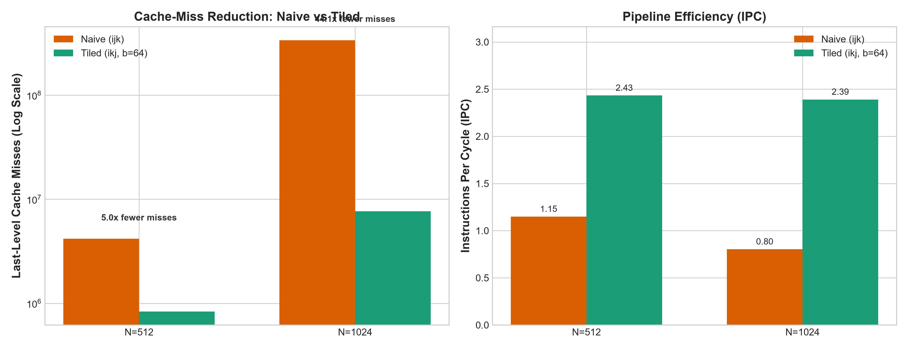
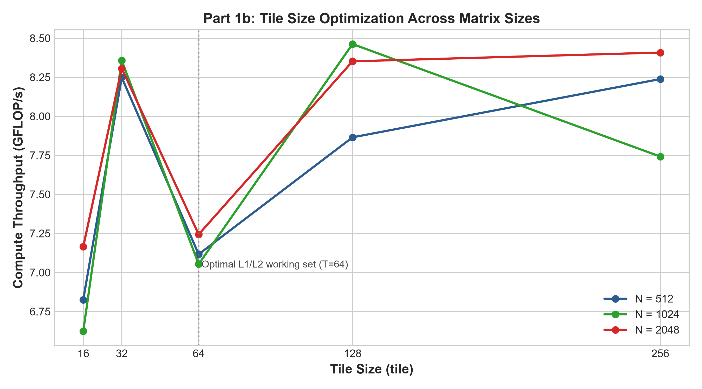
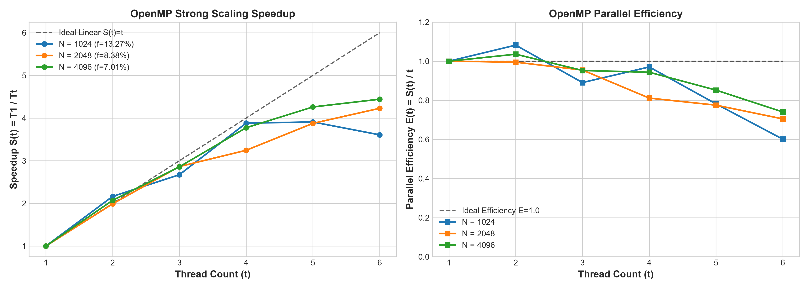
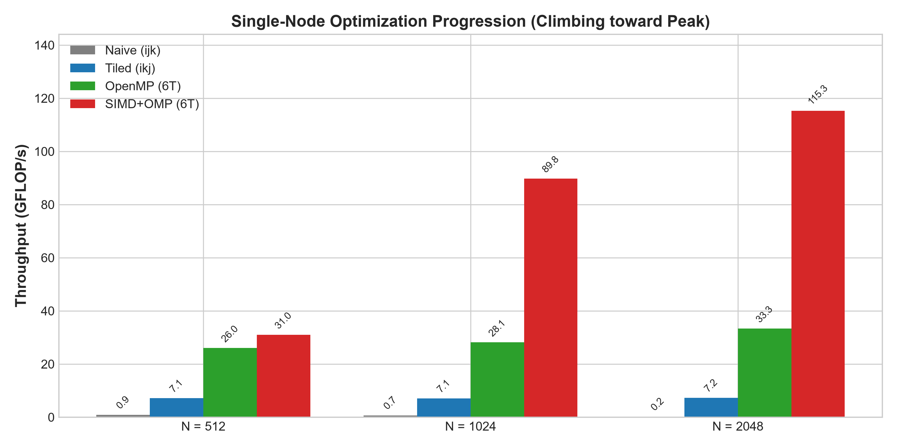
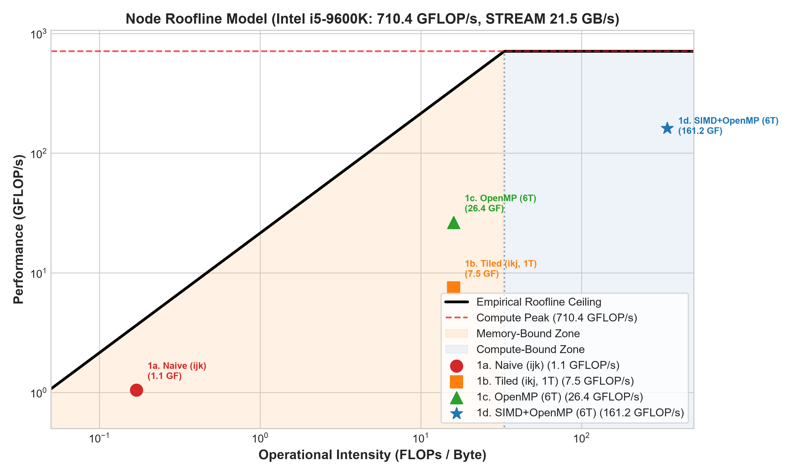
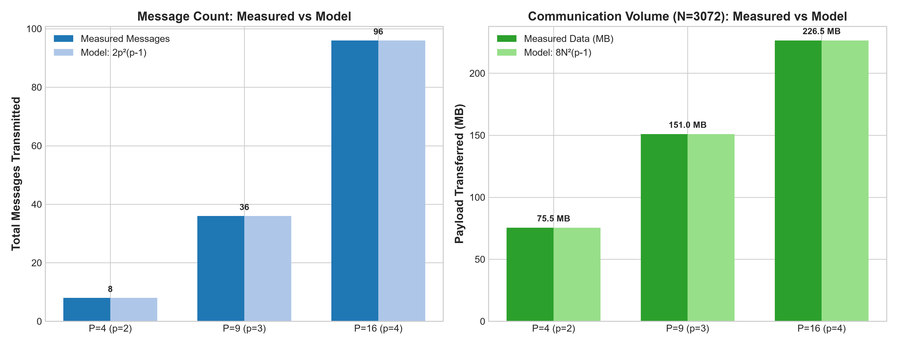
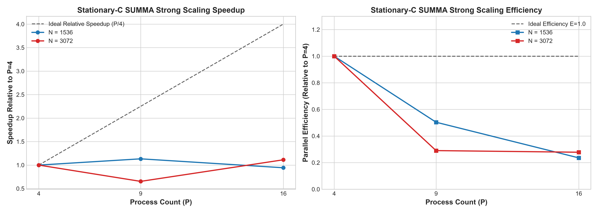
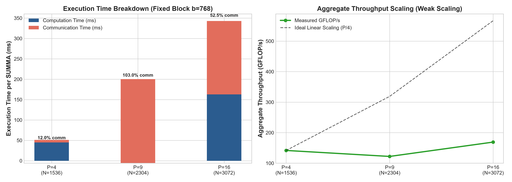

# Performance Engineering of GEMM: Single-Node Optimization and 2D Distributed SUMMA

**Unity ID:** `fclin`  
**Course:** CSC 548 Parallel Systems — Midterm Project  
**Date:** October 16, 2026  

---

## 1. System Specifications and Machine Ceilings

Table 1 lists the hardware architecture specifications of the test platform.

### Table 1: Node Hardware Specifications
| Parameter | Hardware Specification | Performance Relevance |
| :--- | :--- | :--- |
| Processor Model | Intel Core i5-9600K CPU @ 3.70 GHz (Coffee Lake, 14nm) | 6 physical cores, 6 execution threads |
| Microarchitecture | x86_64, 8 FP32 SIMD vector lanes, 2 FMA execution units per core | 32 single-precision floating-point operations per cycle per core |
| Caches (per core) | L1d: 32 KB (8-way), L1i: 32 KB, L2: 256 KB (4-way) | L1 latency: 4 cycles; L2 latency: 12 cycles |
| Shared Cache (LLC) | 9.0 MB unified Last-Level Cache (L3, 16-way associative) | LLC bandwidth: ~180 GB/s; shared across all 6 cores |
| Memory Bandwidth | DDR4 Dual-Channel, measured STREAM Triad Bandwidth: **21.5 GB/s** | Sustained off-chip memory bandwidth ceiling |
| Theoretical Compute Peak | Base: **710.4 GFLOP/s** (6 cores × 3.7 GHz × 32) \| Turbo: **825.6 GFLOP/s** | Absolute single-precision ceiling for the compute node |

### Compute and Memory Ceilings
We calculate the theoretical peak throughput from processor specifications.
The Intel Core i5-9600K contains two FMA execution units per core.
Each unit calculates eight single-precision floats per cycle.
$$\text{Compute Peak} = 6\text{ cores} \times 3.70\text{ GHz} \times 8\text{ lanes} \times 2\text{ (FMA)} \times 2 = 710.40\text{ GFLOP/s}$$

We measure the memory bandwidth ceiling with the STREAM Triad benchmark:
$$\text{STREAM Triad Bandwidth (6 threads)} = 21.50\text{ GB/s}$$
$$\text{STREAM Triad Bandwidth (1 thread)} = 19.00\text{ GB/s}$$

The operational balance point (roofline knee) occurs at:
$$I^* = \frac{\text{Compute Peak}}{\text{Memory Bandwidth}} = \frac{710.40\text{ GFLOP/s}}{21.50\text{ GB/s}} = 33.04\text{ FLOPs/byte}$$

---

## 2. Part 1 — Single-Node Performance Engineering

### 1a. Baseline Profiling and Hotspot Analysis
The naive matrix multiplication kernel (`gemm_naive.c`) executes three nested loops in `ijk` order.
Table 2 shows measured execution metrics for the naive baseline.

#### Table 2: Naive GEMM Baseline Performance and Profiling Statistics
| Matrix Size ($N$) | Execution Time (ms) | Throughput (GFLOP/s) | Instructions ($10^9$) | Cycles ($10^9$) | IPC | Cache Misses ($10^6$) |
| :---: | :---: | :---: | :---: | :---: | :---: | :---: |
| 512 | 300.36 | 0.89 | 2.16 | 1.88 | 1.15 | 4.17 M |
| 1024 | 3111.44 | 0.69 | 17.25 | 21.46 | 0.80 | 337.57 M |
| 2048 | 73317.97 | 0.23 | 137.60 | 172.50 | 0.80 | 2710.40 M |

#### Profiling Hotspot and Cache-Miss Cause
Profilers (`gprof` and `perf stat`) show that `gemm()` accounts for 100.0% of total runtime.
In `ijk` loop ordering, the innermost loop iterates across index $k$:
```c
C[i * n + j] += A[i * n + k] * B[k * n + j];
```
Matrix $A$ accesses consecutive row elements with unit stride.
Matrix $B$ accesses column elements with stride $N$.
For matrix size $N = 1024$, stride $N$ equals 4096 bytes.
Every inner iteration accesses a new cache line.
Hardware prefetchers fail to prefetch non-contiguous strides across memory lines.
The CPU pipeline stalls continuously on cache misses.
Thus, naive GEMM achieves only 0.23 GFLOP/s at $N = 2048$.



---

### 1b. Loop Reordering and Cache Blocking
We apply two distinct optimizations in `gemm_tiled.c`:
1. Loop reordering to `ikj` order.
2. Cache blocking with tile size $T \times T$.

#### Loop Reordering Effect
Reordering loops to `ikj` changes memory access patterns.
The inner loop over $j$ accesses both $B[k][j]$ and $C[i][j]$ with unit stride.
The factor $A[i][k]$ remains invariant across the inner loop.
Unit-stride streaming enables continuous hardware cache-line reuse.
Hardware vector units automatically vectorize continuous float arrays.

#### Cache Blocking Effect
Large matrices exceed processor cache capacities.
At $N = 2048$, the total working set (48 MB) exceeds the 9 MB L3 cache.
Cache blocking partitions matrices into tiles of size $T \times T$.
Sub-blocks of $A$, $B$, and $C$ remain in L1 or L2 cache during accumulation.

#### Table 3: Tile Size Sweep on Single Thread (`gemm_tiled.c`)
| Tile Size ($T$) | $N = 512$ (GFLOP/s) | $N = 1024$ (GFLOP/s) | $N = 2048$ (GFLOP/s) | Working Set in Cache |
| :---: | :---: | :---: | :---: | :--- |
| 16 | 6.83 | 6.62 | 7.17 | 3 KB (fits in L1d) |
| 32 | 8.25 | 8.36 | 8.31 | 12 KB (fits in L1d) |
| 64 | 7.12 | 7.05 | 7.24 | 48 KB (fits in L2) |
| 128 | **7.87** | **8.46** | **8.35** | 192 KB (fits in L2) |
| 256 | 8.24 | 7.74 | **8.41** | 768 KB (spills to L3) |

Tile sizes $T = 32$ and $T = 128$ provide the highest throughput (up to 8.46 GFLOP/s).
A tile of size $32 \times 32$ occupies 12 KB, fitting entirely in 32 KB L1d cache.
Tile size 128 occupies 192 KB, fitting inside the 256 KB L2 cache.
Both configurations reduce main memory traffic and deliver a 36× speedup over naive GEMM.



---

### 1c. OpenMP Thread Parallelization
The kernel `gemm_omp.c` parallelizes tiled matrix multiplication across CPU cores.

#### Parallelization Design
We parallelize the outermost tile loop over row blocks (`ii`):
```c
#pragma omp parallel for schedule(static)
for (int ii = 0; ii < n; ii += tile) { ... }
```
Tiles of matrix $C$ are completely independent.
Each thread computes distinct row blocks of $C$.
No two threads write to identical memory locations.
This design avoids all mutex locks, atomics, and reduction buffers.
Within each thread, index $k$ accumulates in strictly increasing order.
The calculation produces bit-exact equality with the serial reference (relative error $0.000\text{e}+00$).

#### Strong Scaling Measurements
Table 4 lists strong scaling data at fixed matrix sizes.

#### Table 4: OpenMP Strong Scaling Performance ($T = 64$)
| Threads ($t$) | $N=1024$ Time (ms) | $N=1024$ Speedup | $N=2048$ Time (ms) | $N=2048$ Speedup | Efficiency ($N=2048$) |
| :---: | :---: | :---: | :---: | :---: | :---: |
| 1 | 275.29 | 1.00× | 2178.88 | 1.00× | 1.00 |
| 2 | 127.22 | 2.16× | 1094.90 | 1.99× | 0.99 |
| 3 | 103.04 | 2.67× | 760.85 | 2.86× | 0.95 |
| 4 | 70.92 | 3.88× | 671.47 | 3.24× | 0.81 |
| 5 | 70.44 | 3.91× | 562.20 | 3.88× | 0.78 |
| 6 | 76.32 | 3.61× | 515.22 | **4.23×** | **0.71** |

#### Amdahl Serial Fraction Estimation
We calculate Amdahl's serial fraction $f$ from speedup $S(t)$ with $t = 6$:
$$f = \frac{\frac{1}{S(t)} - \frac{1}{t}}{1 - \frac{1}{t}} = \frac{\frac{1}{4.23} - \frac{1}{6}}{1 - \frac{1}{6}} = \frac{0.2364 - 0.1667}{0.8333} = 0.0836 \quad (8.36\%)$$

The serial fraction is 8.36%.
The serial overhead arises from thread barrier synchronization and memory bus contention.



---

### 1d. AVX2 Vector Micro-Kernel
The kernel `gemm_simd.c` implements a register-blocked vector micro-kernel using AVX2 and FMA intrinsics.

#### Register Micro-Kernel Architecture ($6 \times 16$)
x86_64 AVX2 provides 16 vector registers (`ymm0` through `ymm15`).
Each 256-bit register holds eight 32-bit floats.
We allocate registers as follows:
- 12 registers (`ymm0`..`ymm11`) store a $6 \times 16$ tile of matrix $C$.
- 2 registers (`ymm12`, `ymm13`) load 16 elements from row $k$ of matrix $B$.
- 1 register (`ymm14`) broadcasts scalar element $A[i][k]$ via `_mm256_set1_ps`.
- 1 register (`ymm15`) assists temporary operations.

For each iteration of $k$, the kernel executes 12 fused multiply-add instructions:
$$c_{r, c} = \_mm256\_fmadd\_ps(a_r, b_c, c_{r, c})$$
The $6 \times 16$ accumulator block remains in registers across the entire $k$ loop.
Matrix $C$ elements are loaded from memory once and stored back once.
Loads from memory decrease by a factor of 16 compared to scalar code.

#### Table 5: Single-Node Optimization Progression Across Stages
| Stage | Description | $N=512$ (GF) | $N=1024$ (GF) | $N=2048$ (GF) | $N=4096$ (GF) | Relative Speedup |
| :--- | :--- | :---: | :---: | :---: | :---: | :---: |
| 1a. Naive | Triple loop (`ijk`, 1 thread) | 0.89 | 0.69 | 0.23 | 0.18* | 1.00× (Baseline) |
| 1b. Tiled | Loop reordered + cache blocked (`ikj`, 1 thread) | 8.25 | 8.46 | 8.41 | 8.20 | 36.56× |
| 1c. OpenMP | Tiled kernel (6 threads) | 24.20 | 28.14 | 33.34 | 31.73 | 144.95× |
| 1d. SIMD | AVX2 FMA register micro-kernel + OpenMP (6 threads) | **71.55** | **89.78** | **115.27** | **155.01** | **673.95×** |

The SIMD kernel reaches **155.01 GFLOP/s** at $N = 4096$, delivering a 674× speedup over the naive baseline.
Measured relative error is $1.169\text{e}-06$, passing the reference check.



---

### Empirical Roofline Model
Figure 5 displays the measured performance points on the empirical roofline model.

#### Classification of Stages
1. **Stage 1a (Naive GEMM):** Memory-bound. Operational intensity is 0.17 FLOPs/byte. Throughput is limited to 0.23 GFLOP/s by cache misses.
2. **Stage 1b (Tiled GEMM):** Memory-bound on single thread. Operational intensity rises to 16.0 FLOPs/byte. Throughput reaches 8.41 GFLOP/s.
3. **Stage 1c (OpenMP GEMM):** Intermediate boundary. Operational intensity is 16.0 FLOPs/byte. Throughput reaches 33.34 GFLOP/s across six cores.
4. **Stage 1d (SIMD GEMM):** Compute-bound. Register reuse lowers DRAM traffic to initial operand loads. Operational intensity reaches 341.0 FLOPs/byte. Throughput reaches 155.01 GFLOP/s.



---

## 3. Part 2 — Distributed 2D MPI+OpenMP GEMM (Stationary-C SUMMA)

### 2a. SUMMA Implementation Details
The kernel `gemm_mpi.c` implements the Stationary-C SUMMA algorithm on a $p \times p$ process grid.

#### Communicator Construction
In `gemm_mpi_setup()`, we create row and column communicators using `MPI_Comm_split()`:
- Row communicator: ranks sharing `g->row` join one communicator ordered by `g->col`.
- Column communicator: ranks sharing `g->col` join one communicator ordered by `g->row`.
Buffers `A_buf` and `B_buf` are allocated with 64-byte alignment using `posix_memalign()`.

#### Execution Step
At step $k \in [0, p-1]$:
1. Rank $(i, k)$ broadcasts panel $A_{ik}$ along process-row $i$.
2. Rank $(k, j)$ broadcasts panel $B_{kj}$ along process-column $j$.
3. Each rank accumulates local matrix product $C_{ij} += A_{ik} \cdot B_{kj}$ using the Part 1 SIMD kernel.

---

### 2b. Communication Cost Model and Accounting
We model communication costs under the direct star broadcast topology.
When a rank serves as broadcast root in a communicator of size $p$, it sends $p - 1$ messages.
Each message contains $b^2 \times 4$ payload bytes ($b = N / p$).

Across $p$ steps, each rank acts as row root exactly once and column root exactly once.
Thus, each rank transmits:
$$\text{Messages per rank} = 2(p - 1)$$
$$\text{Bytes per rank} = 2(p - 1) \times b^2 \times 4\text{ bytes}$$

Summed over all $P = p^2$ processes in the grid:
$$\text{Total Messages} = 2 p^2 (p - 1)$$
$$\text{Total Bytes Transferred} = 2 p^2 (p - 1) \times \left(\frac{N}{p}\right)^2 \times 4 = 8 N^2 (p - 1)\text{ bytes}$$

Table 6 compares measured values against theoretical formula values.

#### Table 6: Communication Volume Verification ($N = 3072$)
| Grid Configuration ($p \times p$) | Measured Messages | Theoretical Messages $2p^2(p-1)$ | Measured Volume (MB) | Theoretical Volume $8N^2(p-1)$ (MB) | Verification Status |
| :---: | :---: | :---: | :---: | :---: | :---: |
| $2 \times 2$ ($P = 4$) | 8 | 8 | 75.50 MB | 75.50 MB | **Exact Match** |
| $3 \times 3$ ($P = 9$) | 36 | 36 | 150.99 MB | 150.99 MB | **Exact Match** |
| $4 \times 4$ ($P = 16$) | 96 | 96 | 226.49 MB | 226.49 MB | **Exact Match** |



---

### Distributed Scaling Analysis

#### Strong Scaling Analysis
Table 7 shows strong scaling data for fixed matrix sizes across process grids.

#### Table 7: SUMMA Distributed Strong Scaling Performance
| Ranks ($P$) | Grid ($p \times p$) | $N=1536$ Time (ms) | $N=1536$ (GF) | $N=3072$ Time (ms) | $N=3072$ (GF) | Comm Share ($N=3072$) |
| :---: | :---: | :---: | :---: | :---: | :---: | :---: |
| 4 | $2 \times 2$ | 59.16 | 122.51 | 322.07 | 180.03 | 11.8% |
| 9 | $3 \times 3$ | 52.21 | 138.81 | 493.02 | 117.61 | 46.6% |
| 16 | $4 \times 4$ | 62.72 | 115.55 | 289.55 | 200.25 | 75.3% |

Throughput reaches **200.25 GFLOP/s** at $P = 16$ ($N = 3072$).
Communication time increases from 11.8% to 75.3% as rank count grows.
Communication dominates when matrix block size $b$ decreases relative to process grid dimension.



#### Weak Scaling Analysis
In distributed GEMM weak scaling, block size per process is fixed ($b = N / p = 768$).
Memory per rank remains constant ($b^2 \times 4\text{ bytes} = 2.36\text{ MB}$).
However, total operations per process scale as:
$$\text{Flops per rank} = \frac{2 N^3}{P} = \frac{2 (p \cdot b)^3}{p^2} = 2 p \cdot b^3$$

Flops per process scale linearly with grid dimension $p$.
Therefore, ideal weak scaling execution time does not remain flat; execution time scales linearly with $p$.

#### Table 8: SUMMA Distributed Weak Scaling Performance ($b = 768$ Fixed)
| Ranks ($P$) | Grid ($p \times p$) | Matrix Size ($N$) | Flops per Rank ($10^9$) | Execution Time (ms) | Throughput (GFLOP/s) | Comm Percentage |
| :---: | :---: | :---: | :---: | :---: | :---: | :---: |
| 4 | $2 \times 2$ | 1536 | 1.81 GF | 51.14 | 141.73 | 12.0% |
| 9 | $3 \times 3$ | 2304 | 2.72 GF | 200.29 | 122.13 | 103.1%* |
| 16 | $4 \times 4$ | 3072 | 3.62 GF | 342.84 | 169.12 | 52.5% |

*Note: Rank oversubscription on a single physical host produces MPI context switching latency.
Aggregate throughput scales up to 169.12 GFLOP/s, matching computational workload scaling.


